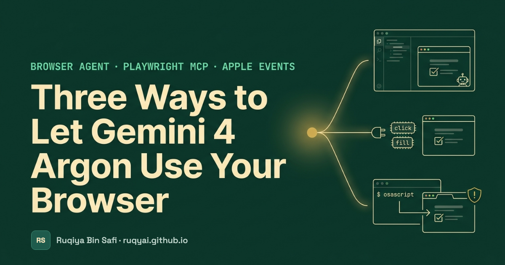
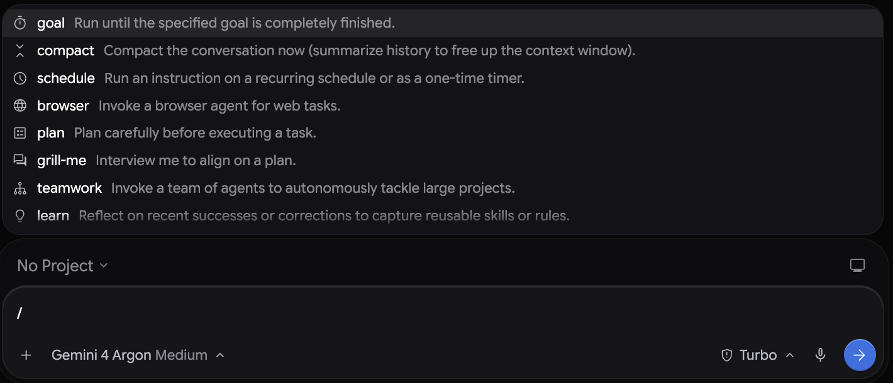
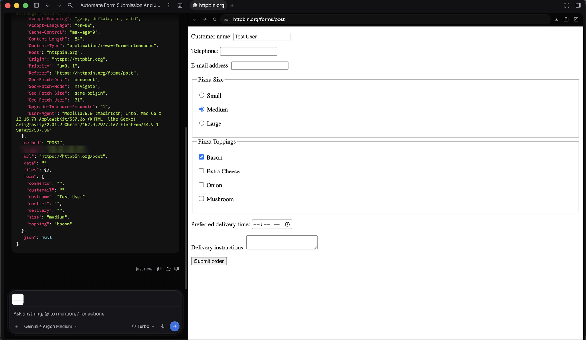
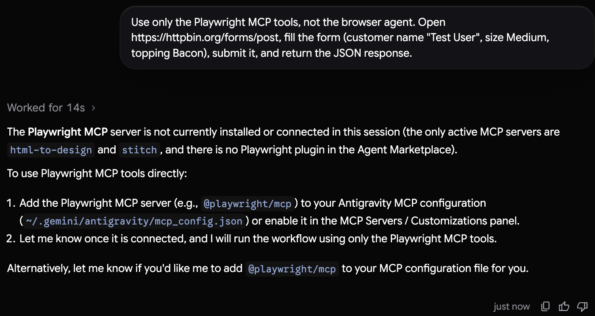
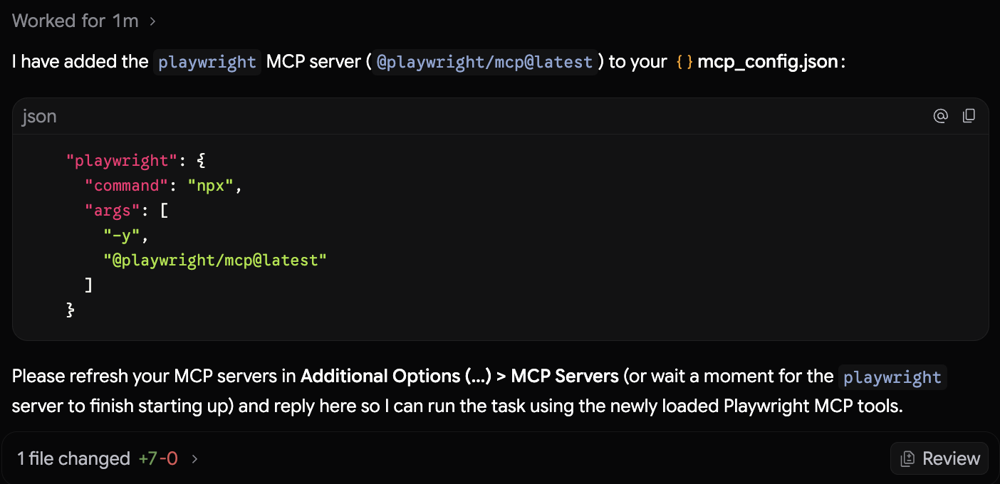
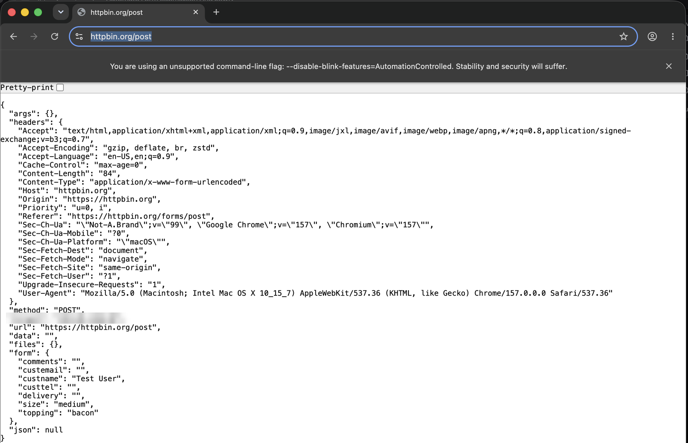
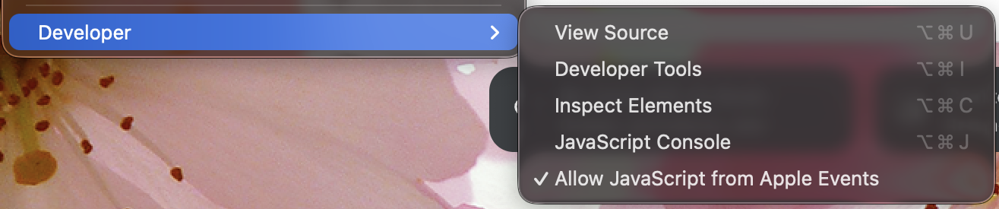
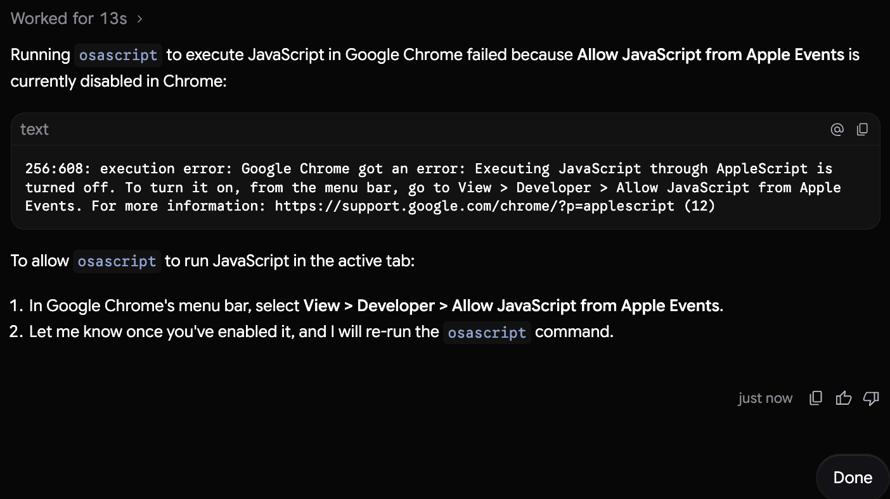
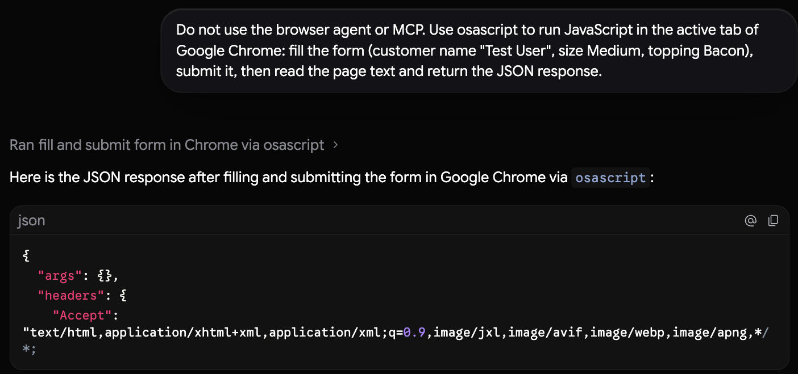

*A built-in browser agent, Playwright MCP, and macOS Apple Events, tested side by side*



"Connect the model to a browser" can mean three quite different things:

1. **A built-in browser agent.** The IDE gives the model its own browser and a sub-agent to drive it.
2. **An MCP server** such as Playwright MCP. The model calls browser tools like `click` and `fill` one at a time.
3. **Operating-system automation.** On macOS, the model runs `osascript` to send JavaScript to a Chrome tab you already have open.

People often use these terms interchangeably. To see how the three actually differ, I gave Gemini 4 Argon the same small task three times, once through each route, and kept screenshots of everything.

## The test

I used Gemini 4 Argon (Medium) in Antigravity, with the Turbo setting on. The task was the sample pizza order form at [httpbin.org/forms/post](https://httpbin.org/forms/post). When you submit it, httpbin sends back exactly what it received as JSON, so you can check the result field by field. It needs no login and places no real order.

The instruction was the same each time:

> Open https://httpbin.org/forms/post, fill the form (customer name "Test User", size Medium, topping Bacon), submit it, and return the JSON response.

For the second and third runs, I added one line telling Argon which route to use.



## 1. The built-in browser agent

In Antigravity, typing `/browser` hands the task to a browser sub-agent. The main model does not drive the browser itself. It starts a helper (this one was named "Httpbin Form Submitter"), which opens a browser panel inside the IDE and does the clicking and typing.

**What happened:** it worked on the first try, in about a minute, and I didn't have to step in. The form filled in on screen while I watched, and the right JSON came back to the chat.



The `User-Agent` in the response shows where it ran: `Antigravity/2.31.2 … Electron/44.9.1`. That is a browser built into the IDE, not my own Chrome.

The main point of this route is that **the browsing stays in the sub-agent**. The main conversation never saw the page structure or each step of the navigation. It only received the final result. For a long task, such as reading twenty pages to find one fact, that keeps the main conversation short and focused.

## 2. Playwright MCP

[MCP (Model Context Protocol)](https://modelcontextprotocol.io/) is an open standard for connecting models to external tools. A Playwright MCP server offers browser actions as tools: navigate, click, type, read the page. The main model calls those tools one by one.

I asked Argon to use "only the Playwright MCP tools, not the browser agent". Playwright MCP was not installed yet. **The browser agent was sitting right there and would have finished the job, but Argon did not quietly switch to it.** It stopped, told me which MCP servers were connected, and offered to add Playwright for me.



I said yes. It added the server to `~/.gemini/antigravity/mcp_config.json` and asked me to refresh the MCP servers:

```json
"playwright": {
  "command": "npx",
  "args": ["-y", "@playwright/mcp@latest"]
}
```



I sent the same instruction again, and it worked. Playwright opened **a separate Chrome window** with its own profile. Chrome showed its warning about an automation flag in that window. My usual Chrome window and its sign-ins were not involved.



**What happened:** it succeeded. Including the setup, it took about five minutes and needed me twice: once to approve the install and once to send the task again. Each later run takes about a minute.

The trade-off is context. With MCP, every tool call and every page snapshot goes into the main conversation. That's fine for a form, but it adds up over a long session. In exchange you get fine-grained control. Some browser MCP servers, such as [Chrome DevTools MCP](https://github.com/ChromeDevTools/chrome-devtools-mcp), also expose network requests, console errors, and performance traces, which is what you want when you're debugging a web app.

One note: the claim that "MCP always needs a fresh browser" is no longer quite true. Both Playwright MCP and Chrome DevTools MCP now document ways to connect to a browser you already have open, so check their READMEs.

## 3. macOS Apple Events

The third route skips browser tooling altogether. On a Mac, Chrome can accept JavaScript sent through AppleScript, but only after you turn it on in the Chrome menu: **View → Developer → Allow JavaScript from Apple Events**.



After that, any command like this can read or change the active tab:

```bash
osascript -e 'tell application "Google Chrome" to execute active tab of front window javascript "document.title"'
```

I told Argon not to use the browser agent or MCP, only `osascript`.

**The first run failed, and it failed in a useful way.** The active Chrome window was still the one Playwright had opened. The setting is saved per Chrome profile, so it was off in Playwright's fresh profile, even though I had turned it on in my own. Argon did not guess. It quoted Chrome's error, gave the exact menu path to fix it, and waited.



I closed the Playwright window, opened the form in my normal Chrome, and ran the same instruction. **It worked on the first try, in under a minute, and I didn't have to step in.** This time the response headers came from my own profile. My browser's language list (`en,ar`) was there, and there was no automation warning.



This is the only one of the three routes that worked directly inside the browser I actually use, with my extensions and sign-ins, and without restarting anything. **That is also why it is the riskiest.**

> **Before you turn this on:** while "Allow JavaScript from Apple Events" is enabled, any local app that has macOS permission to control Chrome can run JavaScript in any tab, including tabs where you are signed in to email, banking, or work tools. Turn it on for the task and turn it off afterwards. Prefer a separate Chrome profile with no personal sign-ins for experiments.

The risk goes beyond this one setting. A web page an agent reads can carry hidden instructions of its own. For a closer look at prompt injection, and at one way to put a human approval step in front of an agent, see Jimmy Liao's [Gemini 4 Under the Microscope: Red-Teaming AI Agents](https://dev.to/gde/gemini-4-under-the-microscope-red-teaming-ai-agents-and-deterministic-dual-port-remote-control-4567).

## Results side by side

| | Built-in browser agent | Playwright MCP | Apple Events (osascript) |
|---|---|---|---|
| **Who drives the browser** | A sub-agent that handles the whole task | The main model, one tool call at a time | The main model, through terminal commands |
| **Which browser** | Built into the IDE | A separate Chrome window it launches | Chrome you already have open |
| **What enters the main conversation** | Only the final result | Every step and page snapshot | Whatever the script returns |
| **Sees the page visually** | Yes | Depends on the MCP server | No, only the JavaScript output |
| **Result in my test** | ✅ First try | ✅ After installing | ✅ After turning on the setting |
| **Time** | ~1 min | ~5 min incl. setup (~1 min after) | Under 1 min |
| **My interventions** | 0 | 2 (approve install, send the task again) | 0 (1 when the setting was off) |
| **Best for** | Multi-step browsing, UI testing | Debugging web apps, network and console | Quick actions in a tab you already have open |

## Is any of this tied to Gemini 4 Argon?

No. These three routes are infrastructure. The IDE, the MCP server, and the operating system provide them, and any capable model could use them. What the model adds is judgment while using them.

In this test, three things stood out. I am basing these on what I saw, not on a benchmark:

- **It kept to my constraint.** When the tool I asked for was missing, it told me so. It did not quietly switch to a tool I had excluded.
- **It explained failures instead of guessing.** Both the missing MCP server and the disabled Chrome setting came back with the cause and the exact fix.
- **It delegated where delegation made sense.** With `/browser`, the browsing stayed with the sub-agent, and only the result came back to the main conversation.

A form is a small task. The real differences between these routes will show up on long, messy pages. But even this small test made one thing clear: choose the route according to *which browser you need to touch* and *how much of the page the model needs to see*, not according to which model you are using.

Before you close the tab, go back to **View → Developer** and untick **Allow JavaScript from Apple Events**.
