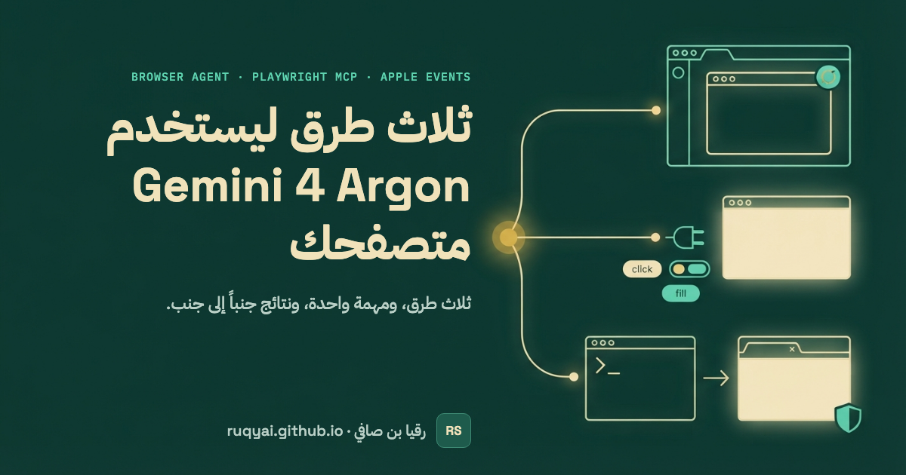
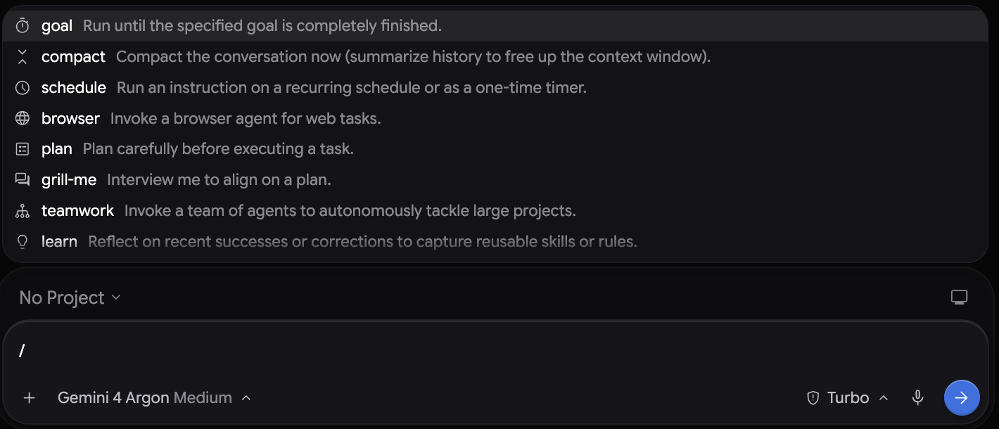
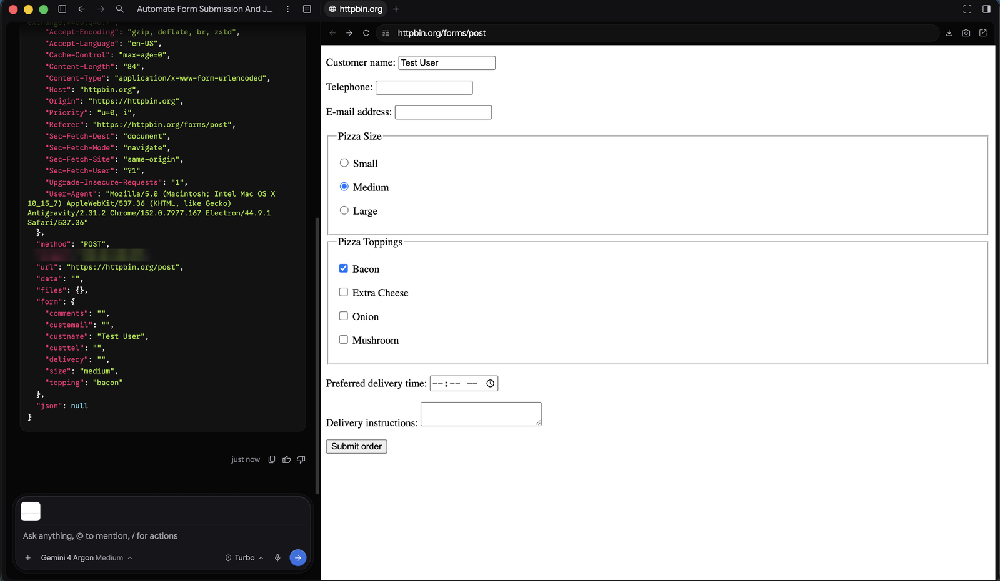
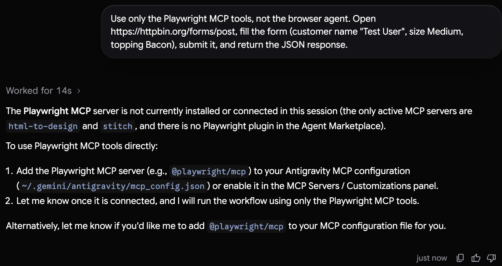
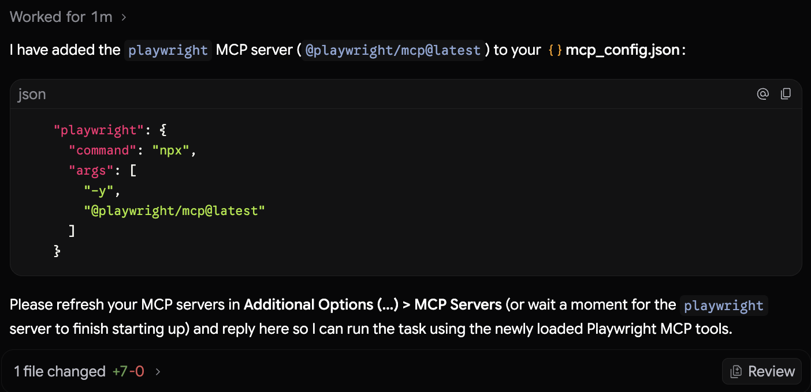
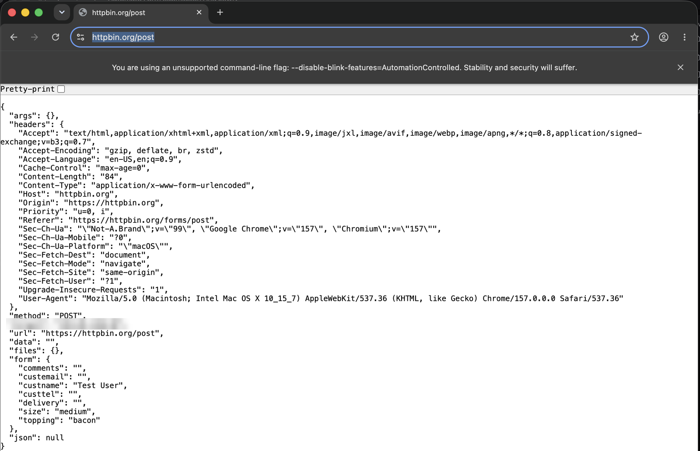
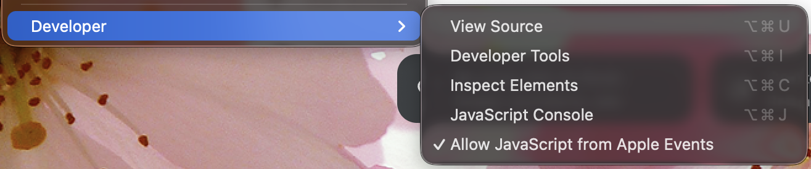
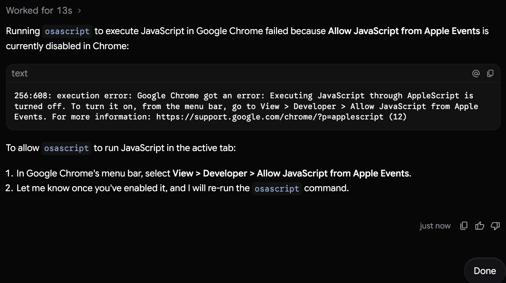
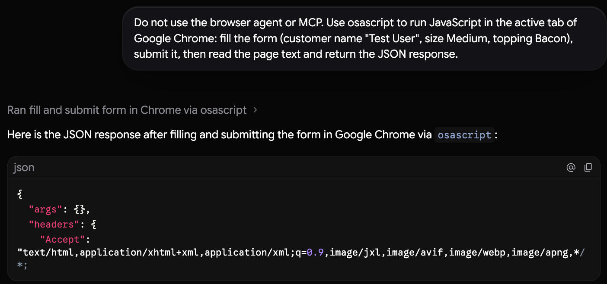

*وكيل متصفح مدمج، وPlaywright MCP، وApple Events في macOS: تجربة عملية جنباً إلى جنب*



عبارة "ربط النموذج بالمتصفح" قد تعني ثلاثة أشياء مختلفة تماماً:

1. **وكيل متصفح مدمج:** بيئة التطوير تعطي النموذج متصفحاً خاصاً ووكيلاً فرعياً يقوده.
2. **خادم MCP** مثل Playwright MCP: النموذج يستدعي أدوات المتصفح، مثل `click` و`fill`، أداةً بعد أداة.
3. **أتمتة نظام التشغيل:** في macOS يشغّل النموذج `osascript` ليرسل JavaScript إلى تبويب مفتوح أصلاً في Chrome.

كثيراً ما تُستخدم هذه المصطلحات كأنها شيء واحد. لأرى الفرق بينها فعلاً، أعطيت Gemini 4 Argon المهمة الصغيرة نفسها ثلاث مرات، مرة عبر كل طريقة، واحتفظت بلقطات شاشة لكل خطوة.

## التجربة

استخدمت Gemini 4 Argon بإعداد Medium داخل Antigravity، مع تفعيل إعداد Turbo. المهمة هي نموذج طلب البيتزا التجريبي في [httpbin.org/forms/post](https://httpbin.org/forms/post). عند إرساله يعيد الموقع ما وصله بالضبط بصيغة JSON، فنتحقق من النتيجة حقلاً حقلاً. لا يحتاج الموقع تسجيل دخول، ولا يُنشئ أي طلب حقيقي.

كان الطلب نفسه في كل مرة:

> Open https://httpbin.org/forms/post, fill the form (customer name "Test User", size Medium, topping Bacon), submit it, and return the JSON response.

في المرتين الثانية والثالثة أضفت سطراً واحداً يحدد الطريقة التي يجب أن يستخدمها Argon.



## 1. وكيل المتصفح المدمج

في Antigravity يكفي أن تكتب `/browser` لتُسلَّم المهمة إلى وكيل متصفح فرعي. النموذج الرئيسي لا يقود المتصفح بنفسه، بل يُطلق مساعداً (سمّاه هنا "Httpbin Form Submitter") يفتح لوحة متصفح داخل بيئة التطوير ويتولى النقر والكتابة.

**ما حدث:** نجح من أول محاولة في نحو دقيقة، دون أي تدخّل مني. كنت أرى النموذج يُعبَّأ أمامي على الشاشة، ثم عاد الـJSON الصحيح إلى المحادثة.



قيمة `User-Agent` في الاستجابة تكشف أين جرى العمل: `Antigravity/2.31.2 … Electron/44.9.1`. أي في متصفح مدمج في بيئة التطوير، وليس في Chrome الخاص بي.

أهم ما في هذه الطريقة أن **التصفح يبقى عند الوكيل الفرعي**. المحادثة الرئيسية لم ترَ بنية الصفحة ولا خطوات التنقل، ووصلتها النتيجة النهائية فقط. في مهمة طويلة، مثل قراءة عشرين صفحة للعثور على معلومة واحدة، يبقي هذا المحادثة الرئيسية قصيرة ومركّزة.

## 2. ‏Playwright MCP

[بروتوكول MCP](https://modelcontextprotocol.io/) معيار مفتوح لربط النماذج بأدوات خارجية. يعرض خادم Playwright MCP أفعال المتصفح كأدوات: الانتقال إلى صفحة، والنقر، والكتابة، وقراءة الصفحة. والنموذج الرئيسي يستدعيها أداةً بعد أداة.

طلبت من Argon أن يستخدم "أدوات Playwright MCP فقط، لا وكيل المتصفح". ولم يكن Playwright MCP مثبتاً بعد. **كان وكيل المتصفح متاحاً وكان سينجز المهمة، لكن Argon لم ينتقل إليه بصمت.** توقّف، وأخبرني بخوادم MCP المتصلة، وعرض أن يضيف Playwright بنفسه.



وافقت، فأضاف الخادم إلى الملف `~/.gemini/antigravity/mcp_config.json`، وطلب مني تحديث خوادم MCP:

```json
"playwright": {
  "command": "npx",
  "args": ["-y", "@playwright/mcp@latest"]
}
```



أرسلت الطلب نفسه مرة أخرى فنجح. فتح Playwright **نافذة Chrome منفصلة** بملف تعريف خاص بها، وظهر فيها تحذير Chrome من خيار أتمتة. نافذتي المعتادة وحساباتي المسجّلة فيها لم تُستخدم.



**ما حدث:** نجح. مع الإعداد استغرق نحو خمس دقائق، واحتاج تدخّلي مرتين: مرة للموافقة على التثبيت، ومرة لإعادة إرسال المهمة. أما التشغيلات اللاحقة فتستغرق نحو دقيقة.

الثمن هنا هو السياق. في MCP يدخل كل استدعاء أداة وكل لقطة صفحة إلى المحادثة الرئيسية. هذا لا يضر في نموذج صغير، لكنه يتراكم في جلسة طويلة. وفي المقابل تحصل على تحكم دقيق. وبعض خوادم MCP الخاصة بالمتصفح، مثل [Chrome DevTools MCP](https://github.com/ChromeDevTools/chrome-devtools-mcp)، تعرض أيضاً طلبات الشبكة وأخطاء الـConsole وقياسات الأداء، وهذا ما تحتاجه عند تصحيح أخطاء تطبيق ويب.

ملاحظة: القول إن "MCP يحتاج دائماً متصفحاً جديداً" لم يعد دقيقاً تماماً. صار في توثيق Playwright MCP وChrome DevTools MCP طرق للاتصال بمتصفح مفتوح أصلاً، فراجع ملفات README الخاصة بهما.

## 3. ‏Apple Events في macOS

الطريقة الثالثة لا تستخدم أدوات المتصفح أصلاً. على الماك يستطيع Chrome استقبال JavaScript عبر AppleScript، لكن بعد تفعيل خيار من قائمة Chrome: **View ← Developer ← Allow JavaScript from Apple Events**.



بعد تفعيله، أي أمر مثل هذا يستطيع قراءة التبويب النشط أو تعديله:

```bash
osascript -e 'tell application "Google Chrome" to execute active tab of front window javascript "document.title"'
```

طلبت من Argon ألا يستخدم وكيل المتصفح ولا MCP، و`osascript` فقط.

**فشلت المحاولة الأولى، لكنه فشل مفيد.** كانت نافذة Chrome النشطة ما تزال النافذة التي فتحها Playwright. والإعداد يُحفظ لكل ملف تعريف في Chrome على حدة، فكان مطفأً في ملف Playwright الجديد مع أنني فعّلته في ملفي. لم يخمّن Argon. نقل رسالة الخطأ من Chrome كما هي، وأعطاني مسار القائمة الذي يحل المشكلة، وانتظر.



أغلقت نافذة Playwright، وفتحت النموذج في Chrome المعتاد، وأعدت الطلب نفسه. **نجح من أول محاولة في أقل من دقيقة، دون أي تدخّل مني.** وهذه المرة جاءت ترويسات الطلب من ملفي الشخصي: قائمة لغات متصفحي (`en,ar`) موجودة، ولا يوجد تحذير الأتمتة.



هذه الطريقة الوحيدة من الثلاث التي عملت مباشرة داخل المتصفح الذي أستخدمه فعلاً، بإضافاتي وحساباتي المسجّلة، ودون إعادة تشغيل أي شيء. **ولهذا السبب نفسه هي الأخطر.**

> **قبل أن تفعّل هذا الخيار:** ما دام "Allow JavaScript from Apple Events" مفعّلاً، يستطيع أي تطبيق على جهازك يملك صلاحية التحكم في Chrome أن يشغّل JavaScript في أي تبويب، بما فيها التبويبات المسجّل فيها دخولك إلى بريدك أو حسابك البنكي أو أدوات العمل. فعّله للمهمة فقط وأطفئه بعدها. والأفضل أن تجرّب في ملف تعريف مستقل في Chrome لا يحمل حساباتك الشخصية.

والخطر لا يقتصر على هذا الإعداد. فالصفحة التي يقرؤها الوكيل قد تحمل تعليمات مخفية خاصة بها. للاطلاع أكثر على حقن الأوامر (prompt injection)، وعلى طريقة لوضع خطوة موافقة بشرية قبل أن ينفّذ الوكيل، اقرأ مقال Jimmy Liao (بالإنجليزية): [Gemini 4 Under the Microscope: Red-Teaming AI Agents](https://dev.to/gde/gemini-4-under-the-microscope-red-teaming-ai-agents-and-deterministic-dual-port-remote-control-4567).

## النتائج جنباً إلى جنب

| | وكيل المتصفح المدمج | ‏Playwright MCP | ‏Apple Events ‏(osascript) |
|---|---|---|---|
| **من يقود المتصفح** | وكيل فرعي يتولى المهمة كاملة | النموذج الرئيسي، أداةً بعد أداة | النموذج الرئيسي، عبر أوامر الطرفية |
| **أي متصفح** | مدمج في بيئة التطوير | نافذة Chrome منفصلة يفتحها | Chrome المفتوح لديك أصلاً |
| **ماذا يدخل المحادثة الرئيسية** | النتيجة النهائية فقط | كل خطوة ولقطة صفحة | ما يعيده السكربت |
| **يرى الصفحة بصرياً** | نعم | حسب خادم MCP | لا، يرى مخرجات JavaScript فقط |
| **النتيجة في تجربتي** | ✅ من أول محاولة | ✅ بعد التثبيت | ✅ بعد تفعيل الإعداد |
| **الوقت** | نحو دقيقة | نحو 5 دقائق مع الإعداد (ثم نحو دقيقة) | أقل من دقيقة |
| **تدخّلي** | 0 | 2 (الموافقة على التثبيت، وإعادة الطلب) | 0 (و1 حين كان الإعداد مطفأً) |
| **الأنسب لـ** | التصفح متعدد الخطوات واختبار الواجهات | تصحيح تطبيقات الويب والشبكة والـConsole | إجراء سريع في تبويب مفتوح لديك أصلاً |

## هل هذه الطرق مرتبطة بـ Gemini 4 Argon؟

لا. هذه الطرق الثلاث بنية تحتية توفرها بيئة التطوير وخادم MCP ونظام التشغيل، وأي نموذج قادر يستطيع استخدامها. ما يضيفه النموذج هو حسن التصرف أثناء استخدامها.

في هذه التجربة لفتتني ثلاثة أشياء، أبنيها على ما رأيته وليس على مقياس أداء:

- **التزم بالقيد.** حين لم تكن الأداة التي طلبتها موجودة، أخبرني بذلك، ولم ينتقل بصمت إلى أداة استثنيتها.
- **شرح الفشل بدل التخمين.** غياب خادم MCP وإعداد Chrome المطفأ رجع كل منهما بالسبب والحل بالضبط.
- **فوّض حيث يفيد التفويض.** مع `/browser` بقي التصفح عند الوكيل الفرعي، ولم يرجع إلى المحادثة الرئيسية إلا النتيجة.

النموذج الذي جرّبته مهمة صغيرة، والفروق الحقيقية بين هذه الطرق ستظهر في الصفحات الطويلة والمعقدة. لكن حتى هذه التجربة الصغيرة توضح شيئاً واحداً: اختر الطريقة حسب *المتصفح الذي تحتاج أن تعمل فيه* و*مقدار ما يحتاج النموذج أن يراه من الصفحة*، لا حسب النموذج الذي تستخدمه.

وقبل أن تغلق الصفحة، ارجع إلى **View ← Developer** وألغِ تفعيل **Allow JavaScript from Apple Events**.
